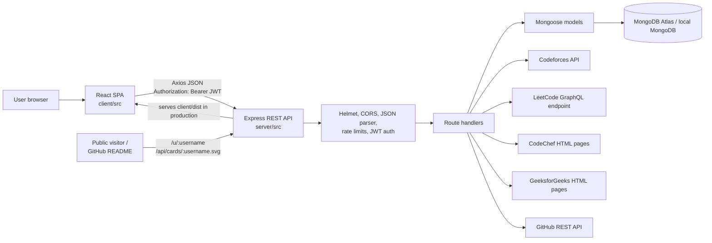
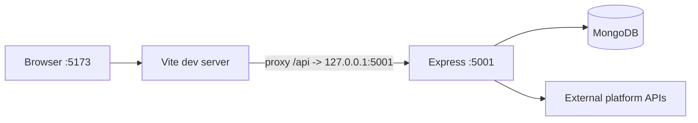
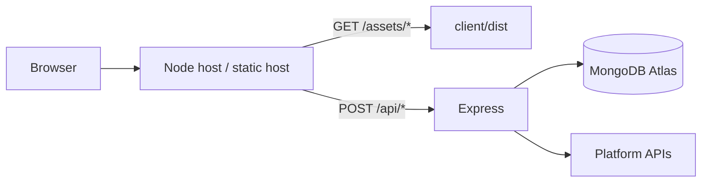
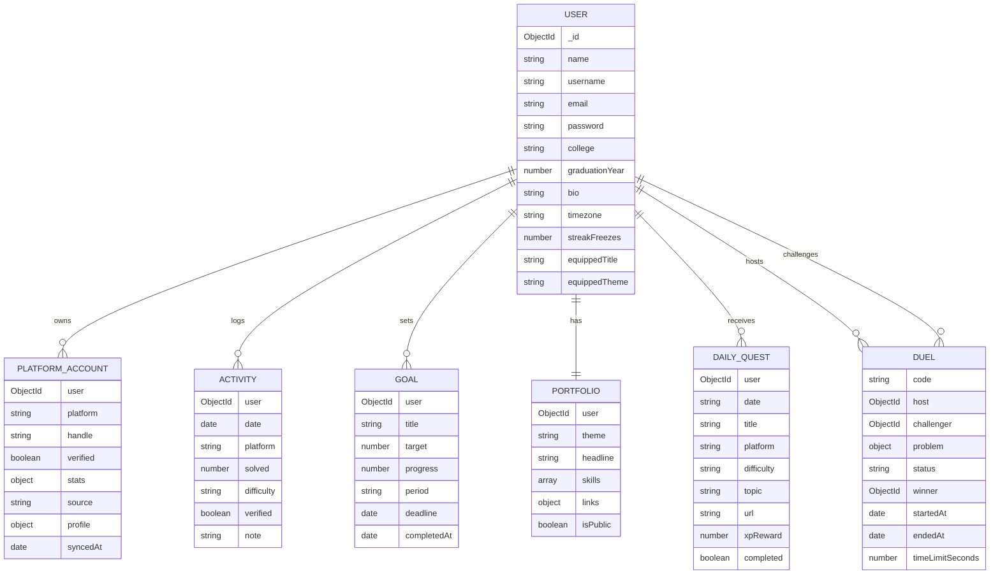
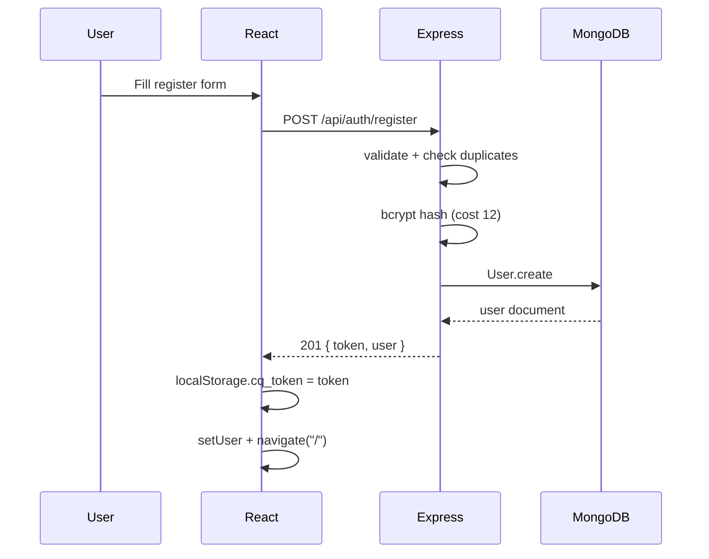

# CodeQuest — Complete Project Master Guide

> This guide is based on a direct inspection of the repository at
> `C:\Users\Lavkush\Desktop\codingQuest\CodeQuest`.
> It explains only what the code actually does. Where the README, the UI, or
> the presentation claims something that the code does not implement, that
> difference is called out explicitly.
>
> No source file was modified during inspection. This guide is the only new file.

---

## Table of contents

1. [Read this first: critical findings](#1-read-this-first-critical-findings)
2. [What CodeQuest is](#2-what-codequest-is)
3. [Architecture](#3-architecture)
4. [Repository map](#4-repository-map)
5. [Every technology explained](#5-every-technology-explained)
6. [Backend deep dive](#6-backend-deep-dive)
7. [Database models and relationships](#7-database-models-and-relationships)
8. [API reference](#8-api-reference)
9. [Business logic and formulas](#9-business-logic-and-formulas)
10. [External integrations](#10-external-integrations)
11. [Frontend deep dive](#11-frontend-deep-dive)
12. [End-to-end flows](#12-end-to-end-flows)
13. [Security review](#13-security-review)
14. [Bugs, gaps, and misleading claims](#14-bugs-gaps-and-misleading-claims)
15. [Run, debug, and deploy](#15-run-debug-and-deploy)
16. [How to modify or add features](#16-how-to-modify-or-add-features)
17. [Viva and interview questions](#17-viva-and-interview-questions)
18. [Study plan](#18-study-plan)
19. [Glossary](#19-glossary)

---

## 1. Read this first: critical findings

### 1.1 Leaked MongoDB credentials in a tracked file

`.env.example` is tracked by Git and contains what appears to be a real MongoDB
Atlas username and password (plus the full connection string). `.env` itself is
ignored by Git, but `.env.example` is committed and also appears in the initial
commit.

**Do this immediately:**

1. Log in to MongoDB Atlas.
2. Change that database user's password (or delete the user and create a new one).
3. Restrict Atlas network access to only your backend host.
4. Remove all real credentials from `.env.example`; replace them with placeholders.
5. Because the secret is in Git history, either rewrite history
   (`git filter-repo` / BFG) or treat the credential as permanently compromised.
6. Check Atlas logs for unexpected connections.
7. Do not paste the real `.env` contents into chats, screenshots, reports, or slides.

The real `.env` also contains the JWT secret and provider keys. Keep it private.

### 1.2 The project is smaller and more simulated than the UI implies

The application is a real working MERN app, but several "advanced" features are
deterministic simulations, not AI or real-time systems:

| UI/README claim | Actual implementation |
|---|---|
| "AI Readiness" / "AI Intelligence Engine" | Fixed arithmetic formulas in `app.js`; no AI model is called. `GEMINI_API_KEY` is never read. |
| "Daily AI Quest" | Picks one of 9 hard-coded problems at random. No AI. |
| "Live 1v1 duel" | REST endpoints only. No WebSocket, no polling, no server-side timer. Either participant can press "I solved it"; any authenticated user can call the finish endpoint. |
| "+100 XP" / "+50 XP" | Only a toast message. XP is recalculated from platform stats; there is no XP ledger and no reward is persisted. |
| "Streak Freeze protects your streak" | Freeze count can be increased without limit; it is never consumed and never used in streak calculation. |
| "Verified Coding Platforms" | Handles are not ownership-verified. Manual/unverified accounts can appear there too. |
| "5 Platforms Live Sync" | LeetCode, Codeforces, CodeChef, GFG, GitHub sync code exists, but LeetCode's endpoint is unofficial and the two scrapers are brittle. |
| "Verified badges" | Badges are computed live from stats; there is no badge collection stored. |

### 1.3 Unused dependencies and environment variables

- `@reduxjs/toolkit` and `react-redux` are installed but never imported.
- `GITHUB_TOKEN`, `GEMINI_API_KEY`, and `CLIENT_URL` are never read by the server.
- `"codequest": "file:.."` is listed as a dependency in both `client` and
  `server`, but nothing imports a package named `codequest`. It is unnecessary
  and can complicate installs.
- `concurrently` is used only by the root dev script.
- Express serves `client/dist` if it exists, but Vite is the dev server.

### 1.4 Configuration mismatches

- `.env` uses `PORT=5001`, `vite.config.js` proxies to `5001`, and
  `server.js` defaults to `5001`.
- `.env.example` and `README.md` say `5000`. A new developer who copies
  `.env.example` gets a backend on 5000 while Vite still proxies to 5001.
- `CLIENT_URL` suggests CORS is restricted to that origin, but the code uses
  `cors({ origin: true })`, which reflects any origin.

### 1.5 Security summary

Good: bcrypt cost 12, JWT expiration, production secret length check, Helmet,
rate limits on auth/sync, ownership checks on most user resources, unique
indexes, password excluded from queries by default, React escaping, SVG escaping.

Weak: JWT stored in `localStorage` (XSS-stealable), CSP disabled, broad CORS,
no email verification/password reset, no token revocation, no handle ownership
verification, public SVG card ignores privacy setting, duel finish has no
authorization check, unlimited free streak freezes, no global rate limit,
leaderboard performs N+1 queries, secrets in Git.

---

## 2. What CodeQuest is

### 2.1 Elevator definition

CodeQuest is a MERN-stack developer progress dashboard. A user creates an
account, connects public coding-platform handles (LeetCode, Codeforces,
CodeChef, GeeksforGeeks, GitHub), and sees a unified view of solved problems,
ratings, activity history, streaks, goals, badges, a community leaderboard, an
interview-readiness estimate, and a public portfolio page plus an embeddable
SVG stats card.

### 2.2 Problem it solves

A developer's progress is scattered:

- LeetCode has solved counts and contest rating.
- Codeforces has rating, rank, and submission history.
- CodeChef has stars and rating.
- GeeksforGeeks has a coding score and solved count.
- GitHub has repositories and followers.

CodeQuest aggregates these into one profile and adds habit-oriented features:
streaks, goals, activity logs, badges, and a shareable public page.

### 2.3 Intended users

- College students preparing for placements.
- Early-career developers building a public coding identity.
- Coding clubs/classmates who want a simple leaderboard.
- Recruiters or peers viewing a public `/u/:username` portfolio.

### 2.4 Features that actually exist

1. Email/password registration and login with JWT.
2. Profile editing (name, bio, college, graduation year, timezone).
3. Platform account sync for 5 platforms, plus manual platform entries via API.
4. Dashboard with solved totals, streak, XP/level, progress score, activity
   heatmap/trend chart, platform list, goals, badges, and Developer DNA radar.
5. Activity log (manual only, explicitly unverified).
6. Goals with create/progress/delete.
7. Leaderboard with global/college filter and search.
8. Public portfolio with theme, headline, skills, links, visibility toggle.
9. Public profile page at `/u/:username`.
10. Embeddable SVG card at `/api/cards/:username.svg`.
11. Company readiness page (heuristic).
12. Daily quest (random curated problem).
13. Duel rooms (REST-based, simulated).
14. Theme toggle (dark/light) persisted in localStorage.
15. Streak freeze counter and developer title selection (cosmetic/simulated).
16. Health check endpoint.
17. Production static serving of the built React app.

### 2.5 Features that do not exist despite the UI/README

- Real AI/Gemini integration.
- GitHub OAuth, email verification, password reset.
- Real-time duels, matchmaking, judging, or anti-cheat.
- Verified activity from platform APIs (history is used for the heatmap, but
  manual logs never become verified).
- Contest feeds, social features, battle administration.
- Username/email changes.
- Real economy/XP spending; streak freezes are free and unlimited.
- Automated tests, linting, TypeScript, Docker, CI.

---

## 3. Architecture

### 3.1 High-level diagram



### 3.2 Development topology



- `npm run dev` runs both servers with `concurrently`.
- Vite serves the React app with HMR on port 5173.
- Vite proxies `/api` to Express on 5001.
- Express uses the root `.env` loaded explicitly by `server.js`.

### 3.3 Production topology



The root `npm run build` installs server and client dependencies, builds the
client, and `npm start` runs the server. If `client/dist` exists, Express serves
it and falls back to `index.html` for non-API routes. Alternatively, the client
can be hosted separately and `VITE_API_URL` set at build time.

### 3.4 Request lifecycle

1. Browser sends an Axios request.
2. `client/src/api.js` adds `Authorization: Bearer <token>` from
   `localStorage.cq_token`.
3. Express runs global middleware: Helmet, CORS, JSON parsing.
4. Route-specific middleware may apply a rate limit.
5. `auth` verifies the JWT, loads the user from MongoDB, and attaches it to
   `req.user`.
6. The route handler validates input, queries/updates Mongoose models, and
   optionally calls a platform integration.
7. The handler sends JSON.
8. Errors go to the final error middleware, which returns a generic 500 (or 409
   for duplicate keys).

---

## 4. Repository map

```text
CodeQuest/
├─ .env                     # real secrets, git-ignored
├─ .env.example             # template (currently contains leaked real values)
├─ .gitignore               # ignores node_modules, .env, client/dist, logs
├─ package.json             # root scripts + concurrently
├─ package-lock.json
├─ README.md                # setup + API overview + scope notes
├─ CodeQuest_Deck.html      # untracked presentation artifact
├─ CodeQuest_Presentation.pptx
├─ CodeQuest_Project_Report.pdf
├─ generate_ppt.py          # tracked helper script for slides
├─ client/
│  ├─ .env                  # VITE_API_URL=/api (git-ignored)
│  ├─ index.html            # Vite HTML entry
│  ├─ vite.config.js        # React plugin, proxy, manual vendor chunks
│  ├─ package.json
│  ├─ dist/                 # built output (git-ignored)
│  └─ src/
│     ├─ main.jsx           # React root + BrowserRouter
│     ├─ App.jsx            # entire UI: 1640 lines, all components
│     ├─ api.js             # Axios instance + auth interceptor
│     └─ styles.css         # 2004 lines of global CSS + themes
└─ server/
   ├─ package.json
   └─ src/
      ├─ server.js          # env load, DNS workaround, Mongo connect, listen
      ├─ app.js             # Express app, all routes, business logic
      ├─ models.js          # 7 Mongoose models
      └─ integrations/
         ├─ codeforces.service.js
         ├─ leetcode.service.js
         ├─ codechef.service.js
         ├─ gfg.service.js
         └─ github.service.js
```

Notable structural facts:

- The backend is not split into controllers/services/routes folders. Almost all
  route logic lives in one 613-line `app.js`.
- The frontend is one 1640-line `App.jsx` with many components in the same file.
- There is no `src/components`, `src/pages`, `src/store`, or `src/hooks` folder.
- There are no tests, ESLint/Prettier configs, TypeScript configs, Docker files,
  or CI workflows.

---

## 5. Every technology explained

The format for each item is: what it is, why it is needed, where it is used,
how it works, what happens without it, alternatives, and why it fits here.

### 5.1 Runtime and language

#### Node.js 20+

- **What:** A JavaScript runtime built on Chrome's V8 engine. It runs JS outside
  the browser and provides filesystem, networking, DNS, and process APIs.
- **Why:** The backend must run JavaScript and handle many concurrent HTTP
  requests without a thread per request.
- **Where:** Everything under `server/`; also runs Vite and build tooling.
- **How:** The event loop delegates I/O to the OS/libuv and executes JS callbacks
  when operations complete. ES modules are enabled by `"type": "module"`.
  `server.js` uses top-level `await import('./app.js')`.
- **Without it:** No backend runtime; you would need another language/runtime.
- **Alternatives:** Deno, Bun, Python/Django, Java/Spring, Go, PHP.
- **Why Node here:** Same language as React, huge ecosystem, simple JSON APIs,
  and native `fetch` in Node 20+ for integrations.

#### JavaScript (ES2022+) with ES Modules

- **What:** The programming language; ESM is the `import`/`export` module system.
- **Why:** Shared language across client and server; ESM is modern and static.
- **Where:** All `.js`/`.jsx` files.
- **How:** `import` statements are resolved at load time; Vite bundles client ESM.
- **Without it:** No application.
- **Alternatives:** TypeScript (typed superset), CoffeeScript (obsolete).
- **Why not TypeScript here:** Faster to generate and simpler for a student
  project; the trade-off is weaker refactoring safety.

#### JSX

- **What:** Syntax sugar that lets you write HTML-like trees in JavaScript.
- **Why:** React components are easier to read as markup.
- **Where:** `App.jsx`, `main.jsx`.
- **How:** Vite's React plugin transforms JSX into `React.createElement` calls
  (or the automatic JSX runtime).
- **Without it:** You would write `React.createElement(...)` manually.
- **Alternatives:** TSX, Vue templates, Svelte templates.

### 5.2 Frontend

#### React 18

- **What:** A component-based UI library. Components are functions returning JSX;
  state changes trigger re-renders.
- **Why:** The dashboard is highly interactive (tabs, forms, charts, modals,
  polling-like refresh), and React makes state-driven UI manageable.
- **Where:** `client/src/main.jsx`, `client/src/App.jsx`.
- **How:** `createRoot` mounts `<App/>`; hooks (`useState`, `useEffect`,
  `useMemo`, `useCallback`) manage state and side effects; React reconciles a
  virtual DOM against the real DOM.
- **Without it:** You would use vanilla DOM manipulation, which becomes
  error-prone for this much UI.
- **Alternatives:** Vue, Svelte, Angular, Solid, Preact.
- **Why React here:** Most popular MERN choice, huge ecosystem, and the AI tools
  generate it reliably.

#### React DOM

- **What:** The renderer that connects React to the browser DOM.
- **Why:** React itself is renderer-agnostic; React DOM is needed for web.
- **Where:** `main.jsx` (`createRoot`).
- **How:** Creates a root and updates DOM nodes during reconciliation.
- **Without it:** React couldn't render to the browser.
- **Alternatives:** React Native (mobile), React Three Fiber (3D).

#### Vite 6

- **What:** A frontend dev server and production bundler.
- **Why:** Fast startup and HMR; simple config; modern ESM-first builds.
- **Where:** `client/vite.config.js`, `npm run dev`, `npm run build`.
- **How:** Dev uses native ESM and esbuild transforms; build uses Rollup to
  produce hashed assets. `manualChunks` splits vendor code into separate files.
- **Without it:** You'd need Webpack/Parcel or no bundler.
- **Alternatives:** Create React App (deprecated), Webpack, Parcel, Rspack,
  Turbopack.
- **Why Vite here:** Minimal config, fast DX, and first-class React support.

#### `@vitejs/plugin-react`

- **What:** Vite plugin enabling React Fast Refresh and JSX transform.
- **Why:** Without it Vite wouldn't understand React JSX/HMR.
- **Where:** `vite.config.js`.
- **How:** Uses Babel/esbuild transforms and injects HMR runtime.
- **Alternatives:** `@vitejs/plugin-react-swc` (faster, SWC-based).

#### React Router DOM 7

- **What:** Client-side routing library.
- **Why:** The app needs a public URL `/u/:username` and navigation helpers.
- **Where:** `main.jsx` wraps the app in `BrowserRouter`; `App.jsx` uses
  `useLocation` and `useNavigate`.
- **How:** `BrowserRouter` uses the History API. `useLocation().pathname` is
  regex-matched for public profiles. The internal workspace does **not** use
  `<Routes>`; page switching is local state.
- **Without it:** Public profile URLs would need manual `window.location`
  parsing, and navigation would be clunkier.
- **Alternatives:** TanStack Router, Wouter, Next.js file routing.
- **Important:** Only `/u/:username` is a real route. Refreshing a workspace page
  always returns to Dashboard because the page is React state, not a URL.

#### Axios

- **What:** A promise-based HTTP client.
- **Why:** Simplifies JSON requests, headers, and error handling.
- **Where:** `client/src/api.js`; every page calls `api.get/post/patch/put/delete`.
- **How:** Creates an instance with `baseURL`; a request interceptor injects the
  JWT. Errors expose `error.response.data.message`.
- **Without it:** Native `fetch` works but requires manual JSON/header handling.
- **Alternatives:** `fetch`, ky, superagent, TanStack Query.
- **Why Axios here:** Interceptors and familiar error shape; the interceptor is
  the main reason it earns its place.

#### React Hook Form

- **What:** A form state/validation library using uncontrolled inputs.
- **Why:** Reduces re-renders and boilerplate for the auth, platform, activity,
  goal, and settings forms.
- **Where:** `AuthScreen`, `PlatformsPage`, `ActivityPage`, `GoalsPage`,
  `SettingsPage`.
- **How:** `useForm` returns `register`, `handleSubmit`, `reset`, `watch`, and
  `formState`; inputs register by name; validation rules run on submit.
- **Without it:** Manual `useState` per field and custom validation.
- **Alternatives:** Formik, React Final Form, TanStack Form, plain state.
- **Note:** `PortfolioPage` does **not** use it; it uses controlled state.

#### Framer Motion

- **What:** A declarative animation library for React.
- **Why:** Adds entrance/fade animations to cards and auth panels.
- **Where:** `motion.div` in auth, stat cards, achievements.
- **How:** Components accept `initial`, `animate`, and `transition` props; the
  library animates styles over time.
- **Without it:** CSS transitions/keyframes only.
- **Alternatives:** CSS animations, React Spring, GSAP.
- **Trade-off:** Adds a ~110 KB vendor chunk for fairly small visual gains.

#### Lucide React

- **What:** A set of SVG icon components.
- **Why:** Consistent iconography without image assets.
- **Where:** Nearly every component (`Code2`, `Flame`, `Trophy`, etc.).
- **How:** Each icon is a React component rendering an `<svg>`; tree-shaking keeps
  only imported icons.
- **Without it:** Emojis, custom SVGs, or another icon pack.
- **Alternatives:** Font Awesome, Heroicons, Material Icons, React Icons.

#### Recharts

- **What:** Composable React chart components built on D3 modules.
- **Why:** Dashboard trend chart and Developer DNA radar chart.
- **Where:** `DashboardPage` (`AreaChart`) and `DeveloperDNACard` (`RadarChart`).
- **How:** Declarative components (`<AreaChart>`, `<XAxis>`, `<Area>`) render SVG;
  `ResponsiveContainer` sizes to the parent.
- **Without it:** Custom SVG/canvas charts or another chart library.
- **Alternatives:** Chart.js/react-chartjs-2, Nivo, Victory, ECharts, D3 directly.
- **Trade-off:** The charts vendor chunk is the largest (~435 KB unminified).

#### Redux Toolkit and React Redux (installed, unused)

- **What:** Official Redux state container and React bindings.
- **Why it would be used:** Shared global state, predictable updates, DevTools.
- **Where:** Nowhere. `grep` finds no imports in `client/src`.
- **How it would work:** `configureStore`, slices with reducers, `useSelector`,
  `useDispatch`, `Provider`.
- **Without it:** The app still works because state is local to `App`,
  `Workspace`, and each page.
- **Alternatives:** Context + useReducer, Zustand, Jotai, TanStack Query.
- **Verdict:** Remove the dependencies or actually adopt a store when prop
  drilling becomes painful. Right now they are dead weight.

#### Google Fonts via CSS `@import`

- **What:** Remote font loading for DM Sans and Space Grotesk.
- **Why:** Typography defines the UI's visual identity.
- **Where:** First line of `styles.css`.
- **How:** Browser fetches the font CSS and font files from Google.
- **Without it:** Fallback sans-serif; slightly different look.
- **Trade-off:** Third-party request, render-blocking CSS import, privacy/GDPR
  considerations. Self-hosting fonts is better for production.

### 5.3 Backend

#### Express 4

- **What:** Minimal Node.js web framework: routing, middleware, request/response
  helpers, static file serving.
- **Why:** REST API with many routes and cross-cutting concerns.
- **Where:** `server/src/app.js`, `server.js`.
- **How:** `app.use` composes middleware; routes match method + path; handlers
  call `res.json`; errors flow to a 4-argument middleware.
- **Without it:** Raw `http.createServer` with manual routing/parsing.
- **Alternatives:** Fastify, Koa, NestJS, Hono, Hapi.
- **Why Express here:** Ubiquitous MERN choice, simple mental model, abundant
  examples.
- **Version note:** Express 4 supports `app.get('*')`; Express 5 changes wildcard
  syntax, so an upgrade would require changes.

#### MongoDB

- **What:** A document-oriented NoSQL database storing BSON documents in
  collections.
- **Why:** User profiles, platform stats, activity, goals, and portfolios are
  naturally nested/variable JSON-like documents; no complex joins are required.
- **Where:** Connection in `server.js`; accessed through Mongoose models.
- **How:** Documents have `_id`; indexes speed queries; Atlas hosts it in the
  cloud. The code defaults to `mongodb://127.0.0.1:27017/codequest` if
  `MONGODB_URI` is missing.
- **Without it:** Data would be lost on restart or need another store.
- **Alternatives:** PostgreSQL, MySQL, SQLite, Firebase, Redis (not primary).
- **Why Mongo here:** MERN convention, flexible schema for platform-specific
  stats, and easy Atlas setup.
- **Trade-off:** Weaker relational integrity; leaderboard aggregation is done in
  JavaScript rather than SQL joins.

#### Mongoose 8

- **What:** An Object Document Mapper (ODM) for MongoDB.
- **Why:** Schemas, validation, casting, indexes, references, middleware, and
  `populate`.
- **Where:** `server/src/models.js`; every route uses models.
- **How:** `new Schema({...})` defines shape; `model()` compiles it; queries
  return documents with methods like `.save()`; `ref` + `populate` resolves
  referenced users.
- **Without it:** Raw MongoDB driver with manual validation/serialization.
- **Alternatives:** Prisma (Mongo support), native driver, TypeORM, MikroORM.
- **Why Mongoose here:** Most common MERN ODM; concise schema definitions.

#### JSON Web Tokens (`jsonwebtoken`)

- **What:** A signed token format (`header.payload.signature`) for stateless auth.
- **Why:** The API needs to identify users across requests without server-side
  sessions.
- **Where:** `tokenFor()` signs; `auth` middleware verifies.
- **How:** Payload `{ id: user.id }`, signed with `JWT_SECRET`, expires in 7 days.
  The client sends it as `Authorization: Bearer <token>`. The server verifies the
  signature and loads the user.
- **Without it:** Server sessions with cookies/Redis, or basic auth.
- **Alternatives:** Sessions + cookies, OAuth/OIDC, PASETO, API keys.
- **Trade-off:** Revocation is hard; a stolen token is valid until expiry. Storing
  it in `localStorage` makes XSS impact severe.

#### bcryptjs

- **What:** A pure-JavaScript implementation of the bcrypt password hashing
  algorithm.
- **Why:** Passwords must never be stored in plaintext; bcrypt is deliberately
  slow and salted.
- **Where:** Registration (`bcrypt.hash(password, 12)`) and login
  (`bcrypt.compare`).
- **How:** Cost factor 12 means 2^12 key-expansion rounds; each hash embeds a
  random salt. `compare` re-hashes the candidate and compares safely.
- **Without it:** Plaintext or weak hashes; catastrophic on database leak.
- **Alternatives:** `bcrypt` (native, faster), Argon2 (modern recommendation),
  scrypt.
- **Why bcryptjs here:** No native build step, works everywhere, simple API.

#### express-validator

- **What:** Middleware built on `validator.js` for request validation/sanitization.
- **Why:** Never trust client input; enforce lengths, formats, enums, ranges.
- **Where:** Registration, login, platform sync/manual, activity, goals, titles.
- **How:** Chains like `body('email').isEmail().normalizeEmail()` run before the
  handler; `validationResult(req)` collects errors.
- **Without it:** Manual `if` checks or a schema validator.
- **Alternatives:** Zod, Joi, Yup, Ajv.
- **Note:** Some routes (profile PATCH, portfolio PUT, duels) have little or no
  validator coverage and rely on Mongoose casting/enums.

#### Helmet

- **What:** Middleware that sets security-related HTTP headers.
- **Why:** Mitigates clickjacking, MIME sniffing, some XSS, etc.
- **Where:** `app.use(helmet({ contentSecurityPolicy: false }))`.
- **How:** Sets headers like `X-Content-Type-Options`, `X-Frame-Options`,
  `Referrer-Policy`, and HSTS (when appropriate).
- **Without it:** Browsers apply fewer protections.
- **Alternatives:** Manual headers, reverse-proxy headers.
- **Caveat:** CSP is disabled, removing a major XSS defense.

#### CORS

- **What:** Cross-Origin Resource Sharing middleware.
- **Why:** In dev, the React app (`:5173`) and API (`:5001`) are different
  origins; the browser blocks cross-origin responses unless the server opts in.
- **Where:** `app.use(cors({ origin: true, credentials: true }))`.
- **How:** Reflects the request's `Origin` and allows credentials.
- **Without it:** Dev requests from Vite would fail unless proxied (they are
  proxied, so production same-origin also works).
- **Alternatives:** Same-origin deployment, reverse proxy, manual headers.
- **Caveat:** `origin: true` is permissive. Since auth uses Bearer tokens rather
  than cookies, the practical CSRF risk is lower, but restricting to known
  origins is still better.

#### express-rate-limit

- **What:** Middleware that limits requests per IP per time window.
- **Why:** Slows brute-force login/registration and platform-sync abuse.
- **Where:** `/api/auth` 40/15 min; `/api/platforms/sync-all` 15/min;
  `/api/platforms/:id/sync` 30/min; `/api/platforms/sync` 20/min.
- **How:** Default in-memory store counts requests keyed by IP; returns 429 when
  exceeded.
- **Without it:** Unlimited password guessing and sync spam.
- **Alternatives:** Redis-backed rate limiting, API gateway, Cloudflare.
- **Caveats:** In-memory counters reset on restart and are per process; behind a
  proxy, IP detection may group users unless `trust proxy` is configured. No
  global limiter protects AI/duel/leaderboard endpoints.

#### dotenv

- **What:** Loads `.env` files into `process.env`.
- **Why:** Keep secrets/config out of source.
- **Where:** `server.js` explicitly loads the root `.env`.
- **How:** Parses `KEY=VALUE` lines and assigns them if not already set.
- **Without it:** Secrets would be hard-coded or exported manually.
- **Alternatives:** Platform env vars (Render/Railway/Vercel), `config`, Doppler,
  AWS Secrets Manager.
- **Note:** Client Vite env vars are separate; only `VITE_*` variables from
  `client/.env` are exposed to the browser.

#### nodemon (dev)

- **What:** Watches files and restarts Node on change.
- **Why:** Backend dev feedback loop.
- **Where:** `npm run dev` in `server/package.json`.
- **Without it:** Manual restarts.
- **Alternatives:** `node --watch`, tsx watch, PM2.

#### Native `fetch` and `AbortSignal.timeout`

- **What:** Node 20's built-in Fetch API and timeout signal.
- **Why:** Call platform APIs without adding Axios/node-fetch on the server.
- **Where:** All five integration services.
- **How:** `fetch(url, { signal: AbortSignal.timeout(12000) })` aborts slow calls.
- **Without it:** Add an HTTP client dependency.
- **Alternatives:** Axios, got, undici (fetch is built on undici).

#### Node core modules

- `node:dns` / `node:net`: custom DNS lookup workaround for Atlas SRV resolution.
- `node:path`, `node:url`: resolve the project root and `client/dist`.
- `node:fs`: check whether the built client exists.

### 5.4 Tooling

#### `concurrently`

- **What:** Runs multiple npm scripts in one terminal.
- **Why:** Root `npm run dev` starts server and client together.
- **Alternatives:** `npm-run-all`, `turbo`, separate terminals.

#### npm `--prefix`

- **What:** Runs a script in another package directory.
- **Why:** The repo has three `package.json` files without npm workspaces.
- **Alternatives:** npm workspaces, pnpm workspaces, Lerna, Nx.

#### `file:..` dependency

- **What:** Instructs npm to install the parent folder as a dependency.
- **Where:** Both `client/package.json` and `server/package.json`.
- **Reality:** Nothing imports `codequest`. This is likely a deployment artifact
  or mistake. It can create confusing installs and should be removed unless a
  real shared package is intended.

---

## 6. Backend deep dive

### 6.1 `server/src/server.js` line by line

```js
import dns from 'node:dns';
import net from 'node:net';
import dotenv from 'dotenv';
import path from 'node:path';
import { fileURLToPath } from 'node:url';
import mongoose from 'mongoose';

dns.setServers(['8.8.8.8', '8.8.4.4', '1.1.1.1']);
```

- Forces DNS resolution through Google/Cloudflare instead of the OS resolver.
- This is a workaround for environments where MongoDB Atlas SRV lookups fail
  (common on some Windows/ISP setups).

```js
const origLookup = dns.lookup;
dns.lookup = (hostname, options, callback) => {
  if (typeof options === 'function') { callback = options; options = {}; }
  if (!hostname || hostname === 'localhost' || net.isIP(hostname)) {
    return origLookup(hostname, options, callback);
  }
  dns.resolve4(hostname, (err, addresses) => {
    if (!err && addresses && addresses.length > 0) {
      if (options && options.all) {
        return callback(null, addresses.map(addr => ({ address: addr, family: 4 })));
      }
      return callback(null, addresses[0], 4);
    }
    return origLookup(hostname, options, callback);
  });
};
```

- Monkey-patches `dns.lookup` to prefer IPv4 A records via `resolve4`.
- Falls back to the original lookup if IPv4 resolution fails.
- **Why:** Atlas SRV records sometimes resolve to IPv6 first, and the host/network
  may not support IPv6.
- **Trade-off:** Global process-wide behavior change; can mask DNS issues and
  forces IPv4 for every hostname.

```js
const projectRoot = path.resolve(path.dirname(fileURLToPath(import.meta.url)), '../../');
dotenv.config({ path: path.join(projectRoot, '.env') });
const { default: app } = await import('./app.js');
```

- Computes the repo root from `server/src/server.js`.
- Loads the root `.env` explicitly, because the process CWD may be `server/`.
- Imports the app **after** env loading, so `process.env` is populated before
  route modules evaluate. This is why `app.js` can read `JWT_SECRET` at request
  time safely.
- Top-level `await` is allowed because `"type": "module"`.

```js
const port = process.env.PORT || 5001;
if (process.env.NODE_ENV === 'production' && (!process.env.JWT_SECRET || process.env.JWT_SECRET.length < 32)) {
  console.error('Set JWT_SECRET ...');
  process.exit(1);
}
```

- Default port 5001 (matches Vite proxy).
- Production fails fast if the JWT secret is missing or too short.
- In development, `app.js` falls back to `'development-only-change-me'`, which is
  convenient but unsafe if `NODE_ENV` is misconfigured.

```js
mongoose.connect(process.env.MONGODB_URI || 'mongodb://127.0.0.1:27017/codequest')
  .then(() => app.listen(port, '0.0.0.0', () => console.log(...)))
  .catch((error) => { console.error(...); process.exit(1); });
```

- Connects before listening; if Mongo is down, the process exits.
- Listens on all interfaces (`0.0.0.0`) so containers/proxies can reach it.
- No graceful shutdown, no connection retry, no connection pool tuning.

### 6.2 `app.js` middleware order

```js
app.use(helmet({ contentSecurityPolicy: false }));
app.use(cors({ origin: true, credentials: true }));
app.use(express.json({ limit: '32kb' }));
app.use('/api/auth', rateLimit({ windowMs: 15 * 60 * 1000, limit: 40 }));
```

Order matters:

1. Security headers first.
2. CORS before routes so preflight/error responses get headers.
3. JSON body parsing with a 32 KB cap.
4. Auth-specific rate limit.

Helpers:

- `fail(res, status, message)` standardizes error JSON.
- `auth` extracts the Bearer token, verifies it, loads the user, attaches
  `req.user`, and returns 401 on failure.
- `handle(fn)` wraps async handlers and forwards rejections to Express's error
  middleware. Express 4 does not catch async errors automatically; this wrapper
  is essential.
- `tokenFor(user)` signs `{ id }` for 7 days.
- `safeUser(user)` whitelists client-safe fields and defaults.

The final error middleware:

```js
app.use((err, req, res, next) => {
  console.error(err);
  if (err.code === 11000) return fail(res, 409, 'That value is already in use.');
  res.status(500).json({ message: 'Something went wrong. Please try again.' });
});
```

- Logs the full error server-side, returns a generic message to clients.
- Maps MongoDB duplicate-key errors to 409.
- Does not distinguish validation errors, so some bad inputs produce 500 instead
  of 400.

### 6.3 Authentication and authorization

**Registration flow** (`POST /api/auth/register`):

1. Validate `name` (2–80), `username` (`^[a-zA-Z0-9_]{3,24}$`), email, password
   (8–72).
2. `validationResult` → first error message with 400.
3. Check `User.exists` for email or lowercase username → 409 if taken.
4. Hash the password with bcrypt cost 12.
5. `User.create`.
6. Return `201 { token, user }`.

**Why `select: false` on password:** Normal queries never load the hash. Login
explicitly calls `.select('+password')`.

**Login flow** (`POST /api/auth/login`):

1. Validate email/password shape (but note: login never checks
   `validationResult`, so malformed input simply fails with 401).
2. Find by normalized email with password selected.
3. `bcrypt.compare`.
4. Return token + safe user.

**Session bootstrap** (`GET /api/auth/me`): The client calls this on load if a
token exists. If it fails, the token is removed.

**Authorization model:**

- Authentication: JWT, stateless, 7-day expiry.
- Authorization: resource queries always include `user: req.user.id` (or
  `_id` + `user`) for platforms, activities, goals, and portfolio. This prevents
  one user from reading/deleting another user's rows by guessing IDs.
- **Exceptions:** leaderboard (all users), public profile (public), SVG card
  (public), duels (any authenticated user can read/finish).

**What is missing:**

- Email verification.
- Password reset.
- Refresh tokens / rotating sessions.
- Token revocation/blacklist.
- Account lockout beyond IP rate limiting.
- 2FA.
- Password change endpoint.
- Handle ownership verification.

### 6.4 Validation and sanitization

- `express-validator` normalizes email (`normalizeEmail`), trims strings, and
  enforces ranges/enums.
- Mongoose enforces schema types, max lengths, enums, and uniqueness.
- React escapes rendered text, reducing XSS.
- SVG card generation escapes `&`, `<`, `>` in the display name; the username is
  constrained by schema.
- **Gaps:** `PATCH /api/profile` and `PUT /api/portfolio` trust body field types
  more than they should; `links` are stored without URL validation; `duel`
  codes and finish requests are barely validated.

---

## 7. Database models and relationships

### 7.1 Relationship diagram



### 7.2 `User`

| Field | Type | Rules/notes |
|---|---|---|
| `name` | String | required, trimmed, max 80 |
| `username` | String | required, unique, lowercase, 3–24 alphanumerics/underscore |
| `email` | String | required, unique, lowercase, trimmed |
| `password` | String | required, `select: false` |
| `college` | String | default `""` |
| `graduationYear` | Number | optional |
| `bio` | String | default `""`, max 280 |
| `timezone` | String | default `Asia/Kolkata` |
| `streakFreezes` | Number | default 1 |
| `equippedTitle` | String | default `Explorer` |
| `equippedTheme` | String | default `cyberpunk` |
| `createdAt` | Date | default now; `timestamps: true` also adds timestamps |

Indexes: unique `username`, unique `email`.

### 7.3 `PlatformAccount`

One document per user per platform (unique compound index `{user, platform}`).

| Field | Notes |
|---|---|
| `platform` | enum: LeetCode, Codeforces, CodeChef, GeeksforGeeks, GitHub |
| `handle` | trimmed, required |
| `verified` | true only after a successful live sync |
| `stats` | `solved`, `easy`, `medium`, `hard`, `rating`, `maxRating`, `rank`, `maxRank`, `history` (Mixed map of date → count) |
| `source` | `manual` or `<platform>-api` |
| `profile` | display name, country, organization, avatar, profile URL |
| `syncedAt` | last sync time |

The `stats.history` object is the source for the dashboard heatmap and streaks.

### 7.4 `Activity`

Manual coding log.

| Field | Notes |
|---|---|
| `date` | required |
| `platform` | required string |
| `solved` | default 0, min 0 |
| `difficulty` | enum easy/medium/hard/mixed |
| `verified` | always `false` for API-created rows |
| `note` | max 160 |

Index: `{user, date, platform}` (non-unique).

Important consequence: because `POST /api/activity` forces `verified: false`, and
the dashboard only aggregates `verified: true` activities, **manual activity
never contributes to streaks, score, or verified days**. The heatmap is populated
only by platform `stats.history`.

### 7.5 `Goal`

| Field | Notes |
|---|---|
| `title` | required, max 100 |
| `target` | required, min 1 |
| `progress` | default 0 |
| `period` | daily/weekly/monthly |
| `deadline` | optional date |
| `completedAt` | set when progress reaches target |

No automatic reset per period; a "weekly" goal is just a label.

### 7.6 `Portfolio`

One-to-one with user (unique `user`).

| Field | Notes |
|---|---|
| `theme` | midnight/violet/emerald |
| `headline` | max 120, default "Building thoughtful software." |
| `skills` | array of strings, max 32 each |
| `links` | `{ github, website, linkedin }` |
| `isPublic` | default true |

`GET /api/portfolio` creates a document if missing (a side effect in a GET).

### 7.7 `DailyQuest`

One per user per date (unique `{user, date}`). Date is a `YYYY-MM-DD` string.

### 7.8 `Duel`

| Field | Notes |
|---|---|
| `code` | unique uppercase 6-char room code |
| `host` | required user ref |
| `challenger` | optional user ref |
| `problem` | embedded title/difficulty/url/platform |
| `status` | waiting/active/completed |
| `winner` | optional user ref |
| `startedAt`, `endedAt` | timestamps |
| `timeLimitSeconds` | default 900 |

---

## 8. API reference

Base URL: `http://localhost:5001/api` in dev, or same-origin `/api` in
production. Authenticated routes require `Authorization: Bearer <jwt>`.

### 8.1 Auth and profile

| Method | Path | Auth | Purpose |
|---|---|---|---|
| GET | `/health` | No | `{ status: "ok", service: "CodeQuest API" }` |
| POST | `/auth/register` | No | Create account; returns token + safe user |
| POST | `/auth/login` | No | Verify credentials; returns token + safe user |
| GET | `/auth/me` | Yes | Current safe user |
| PATCH | `/profile` | Yes | Update name, bio, college, graduationYear, timezone |

### 8.2 Platforms

| Method | Path | Auth | Purpose |
|---|---|---|---|
| GET | `/platforms` | Yes | List the user's platform accounts |
| POST | `/platforms/sync` | Yes | Fetch live data for a platform/handle and upsert |
| POST | `/platforms` | Yes | Save manual, unverified figures |
| POST | `/platforms/sync-all` | Yes | Refresh every connected account sequentially |
| POST | `/platforms/:id/sync` | Yes | Refresh one connected account |
| DELETE | `/platforms/:id` | Yes | Disconnect an account |

### 8.3 Dashboard and activity

| Method | Path | Auth | Purpose |
|---|---|---|---|
| GET | `/dashboard` | Yes | Aggregated stats, accounts, goals, heatmap, badges, DNA |
| GET | `/activity` | Yes | Last 100 manual activity rows |
| POST | `/activity` | Yes | Create an unverified manual log |

### 8.4 Goals

| Method | Path | Auth | Purpose |
|---|---|---|---|
| GET | `/goals` | Yes | All goals, newest first |
| POST | `/goals` | Yes | Create a goal |
| PATCH | `/goals/:id/progress` | Yes | Increment progress; auto-complete at target |
| DELETE | `/goals/:id` | Yes | Delete a goal |

### 8.5 Leaderboard, portfolio, public data

| Method | Path | Auth | Purpose |
|---|---|---|---|
| GET | `/leaderboard` | Yes | Top 50 by progress score |
| GET | `/portfolio` | Yes | Get/create the user's portfolio |
| PUT | `/portfolio` | Yes | Update portfolio fields |
| GET | `/public/:username` | No | Public profile if portfolio is public |
| GET | `/cards/:username.svg` | No | Embeddable SVG stats card |

### 8.6 Simulated AI and game features

| Method | Path | Auth | Purpose |
|---|---|---|---|
| GET | `/ai/readiness` | Yes | Heuristic company readiness scores |
| GET | `/ai/daily-quest` | Yes | Get/create today's random quest |
| POST | `/ai/daily-quest/complete` | Yes | Mark quest complete (no XP persisted) |
| POST | `/user/buy-freeze` | Yes | Increment freeze counter |
| POST | `/user/equip-title` | Yes | Set cosmetic title |

### 8.7 Duels

| Method | Path | Auth | Purpose |
|---|---|---|---|
| POST | `/duels/create` | Yes | Create a room with random code/problem |
| POST | `/duels/join/:code` | Yes | Join a waiting room |
| GET | `/duels/:code` | Yes | Fetch room state |
| POST | `/duels/:code/finish` | Yes | Mark completed and set winner to caller |

### 8.8 Static SPA fallback

If `client/dist` exists, Express serves it and returns `index.html` for any
non-`/api` path. This makes `/u/:username` work on refresh in production.

---

## 9. Business logic and formulas

All formulas below are in `server/src/app.js`.

### 9.1 Dashboard aggregation

```text
solved        = Σ account.stats.solved
verifiedSolved= Σ Activity.solved where verified = true
totalSolved   = solved + verifiedSolved
```

Because the activity POST always stores `verified: false`, `verifiedSolved` is
normally 0.

Daily activity map:

- For each platform account, merge `stats.history` entries (`YYYY-MM-DD` → count).
- Add verified activities by date.
- Sort dates ascending.

Streak:

```text
current run = 1
for each consecutive date:
  if date - previousDate == 1 day: current++
  else: current = 1
longest = max(longest, current)
streak = current if lastDate is today or yesterday, else 0
```

Progress score (0–100):

```text
score = round(
  min(solved, 500) / 500 * 35 +
  min(longest, 30) / 30 * 25 +
  min(accounts.length, 4) / 4 * 15 +
  min(verifiedActivities.length, 100) / 100 * 25
)
score = min(100, score)
```

XP and level:

```text
xp    = totalSolved * 10 + longest * 25 + accounts.length * 50
level = max(1, floor(xp / 500) + 1)
```

Badges:

| Badge | Unlock condition |
|---|---|
| First Steps | `totalSolved >= 1` or at least one account |
| Multi-Platform | at least 2 accounts |
| Streak Master | longest or current streak ≥ 3 |
| Century Club | totalSolved ≥ 100 |
| Problem Slayer | totalSolved ≥ 500 |
| Rating Champion | highest rating ≥ 1600 |

### 9.2 Developer DNA

Inputs per platform:

- LeetCode: solved, easy, medium, hard, rating.
- Codeforces: rating, solved.
- GitHub: `solved` is actually `public_repos`; `rating` is actually `followers`.

Scores (each clamped to 100):

```text
dsScore             = lcEasy*0.15 + lcMedium*0.4 + lcHard*0.9 + lcSolved*0.1
algoScore           = cfRating/18 + cfSolved*0.2 + (highestRating>1400 ? (highestRating-1400)/10 : 0)
devScore            = ghRepos*4.5 + ghFollowers*5 + 20
gritScore           = streak*3.5 + verifiedDays*0.3 + 25
problemSolvingScore = totalSolved/7 + 25
mathScore           = cfRating/22 + lcMedium*0.25 + 30
```

Radar values are floored (e.g., Data Structures min 25, Algorithms min 20) so the
chart never looks empty.

Archetype precedence:

1. `highestRating >= 1600` or `cfRating >= 1600` → Grandmaster Algorithmist
2. `lcSolved >= 350` → DSA Specialist
3. `ghRepos >= 6 && totalSolved >= 150` → Full-Stack Craftsman
4. `streak >= 14 || verifiedDays >= 50` → Tenacious Grinder
5. `accounts.length >= 3` → Polyglot Problem Solver
6. else Rising Challenger

### 9.3 Leaderboard

```text
score = min(100, round(solved / 5 + verifiedActivityCount / 4))
```

- `solved` is the sum of platform solved counts.
- `verifiedActivityCount` is the number of verified activity documents, not the
  sum of solved counts.
- This is different from the dashboard score formula.
- Rows are sorted by score, then solved, and sliced to 50.
- Implementation loads **all users**, then runs two queries per user
  (N+1 pattern), which will not scale.

### 9.4 Readiness

```text
google    = clamp(round(hard*1.6 + medium*0.22 + max(0, rating-1400)*0.14 + 36), 38, 97)
amazon    = clamp(round(medium*0.32 + easy*0.1 + 48), 45, 98)
microsoft = clamp(round(totalSolved*0.08 + medium*0.24 + 46), 46, 98)
meta      = clamp(round(medium*0.28 + max(0, rating-1300)*0.10 + 38), 36, 96)
startup   = clamp(round(totalSolved*0.09 + 52), 50, 99)
average   = round((google + amazon + microsoft + meta + startup) / 5)
```

Status is "Ready/Target/Interview" at ≥75, otherwise a progress label. This is a
heuristic, not a prediction or an AI model.

### 9.5 SVG card

```text
totalSolved   = Σ account.stats.solved
highestRating = max account.stats.rating
xp            = totalSolved*10 + accounts.length*50
level         = floor(xp/500)+1
displayedStreak = max(1, accounts.length*3)   // not the real streak
```

The card is generated as a string of SVG with gradients, escaped name, and
`Cache-Control: public, max-age=1800`.

---

## 10. External integrations

### 10.1 Sync flow

`POST /api/platforms/sync`:

1. Validate platform enum and handle length.
2. `syncPlatformData(platform, handle)` dispatches to the appropriate service.
3. Each service returns `{ handle, stats, profile }`.
4. Upsert `PlatformAccount` by `{user, platform}` with:
   - normalized handle
   - stats
   - profile
   - `source = "<platform>-api"`
   - `syncedAt = now`
   - `verified = true`
5. Return the saved account.

Errors:

- "not found" → 404.
- everything else → 502.

`sync-all` loops sequentially, collects per-platform errors, and returns a note.
Because Codeforces waits ~2.2 s between calls, a user with several accounts can
wait many seconds; hosting request timeouts are possible.

### 10.2 LeetCode (`leetcode.service.js`)

- **Method:** POST to `https://leetcode.com/graphql` with an unofficial GraphQL
  query.
- **Data:** matched user, submission calendar, accepted submission counts by
  difficulty, profile, contest ranking.
- **Stats:** solved/easy/medium/hard, contest rating, rank/badge, daily history
  parsed from `submissionCalendar`.
- **Headers:** spoofed `Referer` and browser `User-Agent`.
- **Timeout:** 12 s.
- **Failure:** non-OK response → "LeetCode is currently unreachable"; missing
  user → not found.
- **Reality check:** This endpoint is unofficial and can change or block server
  IPs without notice. The README says LeetCode scraping is intentionally not
  used; this is GraphQL rather than HTML scraping, but it is still an
  undocumented interface and should be labeled as such.
- **Ownership:** Entering a username does not prove the account belongs to the
  user.

### 10.3 Codeforces (`codeforces.service.js`)

- **Method:** Official public API.
  - `user.info?handles=...`
  - `user.status?handle=...&from=1&count=10000`
- **Rate limiting:** A module-level promise queue enforces ~2.2 s between
  requests because Codeforces limits roughly one request every two seconds.
- **Solved count:** Unique accepted problems keyed by `contestId-index`.
- **History:** Date of the first accepted submission per unique problem.
- **Stats:** current/max rating, rank/max rank, solved, history.
- **Profile:** name, country, organization, avatar, URL.
- **Timeout:** 12 s / 15 s.
- **Failure:** API errors and not-found are mapped to readable messages.
- **Limitation:** `count=10000` may not include every submission for extremely
  active users; history is first-solve dates, not all activity.

### 10.4 CodeChef (`codechef.service.js`)

- **Method:** Fetch the public HTML profile page and parse with regular
  expressions.
- **Data:** rating number, highest rating, total problems solved, star rating,
  name, country.
- **Fragility:** Any HTML/markup change breaks the regexes. There is no official
  public API used.
- **Legal/ethical:** Scraping may conflict with the site's terms; check before
  deploying publicly.

### 10.5 GeeksforGeeks (`gfg.service.js`)

- **Method:** Fetch the public profile HTML and parse embedded JSON-ish text.
- **Data:** total problems solved, coding score, display name, avatar.
- **Fragility:** Regexes depend on serialized page internals; likely to break.
- **Legal/ethical:** Same scraping caveat.

### 10.6 GitHub (`github.service.js`)

- **Method:** `GET https://api.github.com/users/:handle` with a custom
  `User-Agent`.
- **Data:** `public_repos` → `stats.solved`, `followers` → `stats.rating`, name,
  avatar, URL.
- **Auth:** None. `GITHUB_TOKEN` is never used. Unauthenticated GitHub API is
  limited to 60 requests/hour per IP, so syncs can fail under load.
- **Semantic bug:** Repositories are counted as "problems solved" throughout the
  dashboard and leaderboard.

### 10.7 Verification semantics

- A successful live sync sets `verified: true`.
- That means "this public handle returned data", **not** "this account belongs to
  the logged-in user".
- Anyone can claim any public handle. Multiple users can claim the same handle.
- Manual platform entries and manual activity remain unverified by design.

---

## 11. Frontend deep dive

### 11.1 Boot sequence

`main.jsx`:

```jsx
createRoot(document.getElementById('root')).render(
  <React.StrictMode>
    <BrowserRouter>
      <App />
    </BrowserRouter>
  </React.StrictMode>
);
```

`App`:

1. Reads theme from `localStorage.cq_theme` (default dark).
2. Applies `data-theme` and `light-theme`/`dark-theme` classes to the document.
3. If `/u/:username` matches, renders `PublicProfile` immediately.
4. If a token exists, calls `GET /auth/me`.
5. Shows a loading screen until auth bootstrap completes.
6. If no user, renders `AuthScreen`.
7. Otherwise renders `Workspace`.

`api.js`:

```js
const api = axios.create({ baseURL: import.meta.env.VITE_API_URL || '/api' });
api.interceptors.request.use(config => {
  const token = localStorage.getItem('cq_token');
  if (token) config.headers.Authorization = `Bearer ${token}`;
  return config;
});
```

### 11.2 Auth screen

- Tab switch between login and register; resets the form.
- Register fields: full name, username, email, password.
- Login fields: email, password.
- `react-hook-form` validates required fields, username pattern, password length.
- Password visibility toggle.
- Theme toggle.
- Left side is a **hard-coded marketing preview** ("Alex Developer", 253 solved,
  1640 rating). It is not live data.
- Submit calls `POST /auth/login` or `/auth/register`, stores `cq_token`, sets
  user, navigates to `/`.

### 11.3 Workspace shell

`Workspace` holds:

- `page`: current internal page name (default Dashboard).
- `mobileNav`: sidebar state.
- `toast`: transient notification.
- `dashboard`: data from `GET /dashboard`.
- `refreshKey`: incrementing counter that triggers re-fetch.

`reload()` increments `refreshKey`; the dashboard `useEffect` depends on it, so
the whole dashboard reloads after mutations.

Navigation is an array of names rendered as sidebar buttons. There are no URLs
for internal pages. `PageContent` maps the name to a component.

Top bar:

- Mobile menu.
- Breadcrumb.
- Theme toggle.
- "Refresh Stats" → `POST /platforms/sync-all`.
- Streak freeze pill → `POST /user/buy-freeze`.
- Search box: **decorative**, no handler.
- Notifications: shows a toast "You're all caught up."
- Avatar.

Sidebar:

- Brand, nav, "next milestone" (solves to 100), user menu/logout.
- Achievements badge count is hard-coded to `2`.

### 11.4 Dashboard page

Data from `GET /dashboard`:

- Four stat cards: solved, current streak, XP/level, developer score.
- Daily quest widget.
- Activity panel with Heatmap/Trend tabs.
- Developer DNA radar.
- Level panel with progress to next level.
- Synced platforms list (first 4).
- Goals in motion (first 3).
- Achievements grid.
- Bottom callouts.

Heatmap:

- Builds 52 weeks × 7 days ending on the upcoming Saturday.
- Maps activity date → count.
- Levels: 0, 1–2, 3–4, 5–7, 8+.
- Shows active days, current streak, longest streak.
- Uses UTC date strings (`toISOString`), which can shift dates for users in
  non-UTC timezones.
- Month labels are positioned by week index.

Trend chart:

- Last 30 activity buckets from the server.
- Area chart of `count` per day.

### 11.5 Platforms page

- Lists connected accounts in a table.
- "Sync account" opens a form: platform select + handle.
- Submit calls `POST /platforms/sync` (live sync), not the manual endpoint.
- Per-row "Sync" calls `POST /platforms/:id/sync`.
- "Refresh All" calls `POST /platforms/sync-all`.
- "Remove" calls `DELETE /platforms/:id`.
- Shows source tag "Live API" vs "Manual".
- LeetCode row shows easy/medium/hard and contest rating.
- Codeforces row shows rating/max/rank.
- Other platforms show rating/rank.

### 11.6 Activity page

- Form: date (default today), platform, solved, difficulty, optional note.
- `POST /activity`; the response includes a warning that it is unverified.
- Table of recent logs, all tagged "Unverified".
- Note: it never affects streaks/score.

### 11.7 Goals page

- Create goal: title, period, target.
- Each goal card shows progress bar and percentage.
- "Record progress" sends `PATCH /goals/:id/progress` with increment 1.
- Delete sends `DELETE /goals/:id`.
- Goals do not reset automatically per period.

### 11.8 Achievements page

- Displays badges computed by the dashboard endpoint.
- Progress ring: unlocked / total.
- Tier labels: COMMON, RARE, EPIC, LEGENDARY.
- Badges are not stored; they are recalculated on every dashboard request.

### 11.9 Leaderboard page

- `GET /leaderboard`.
- Filter: Global or My college (client-side).
- Search by name/username/college (client-side).
- Highlights the current user.
- Shows rank, developer, college, problems, score/100.
- Explainer explicitly says it is a progress metric, not skill/employability.

### 11.10 Portfolio page

- Loads `GET /portfolio`.
- Editable: headline, theme, skills (up to 12), GitHub URL, website, public
  toggle.
- Save: `PUT /portfolio`.
- Live preview on the right. **Preview hard-codes SOLVES as 0.**
- Copy profile link: `${origin}/u/${username}`.
- GitHub README section shows the SVG card and Markdown:
  `[](.../u/user)`.
- "Dossier PDF" uses `window.print()`.
- Links are stored but not rendered on the public profile.

### 11.11 Settings page

- Profile form: name, username (disabled), email (disabled), college,
  graduation year, timezone, bio.
- Developer title select → immediate `POST /user/equip-title`.
- Theme selector (dark/light) → local state + localStorage.
- Streak freeze section → `POST /user/buy-freeze`.
- Save → `PATCH /profile`.

### 11.12 Public profile

- URL: `/u/:username`.
- Calls `GET /public/:username`.
- Requires a `Portfolio` document with `isPublic: true`.
- Shows name, username, college, headline, Developer DNA card, skills, platform
  stats, print button, and "Create your own".
- Does not show portfolio links.
- Platforms are labeled "Verified" even if the row is unverified.

### 11.13 Styling and theming

- One global `styles.css` (~2004 lines).
- CSS custom properties for core colors.
- Dark theme by default; light theme via `body.light-theme` and
  `[data-theme="light"]` overrides.
- Responsive breakpoints: 1120 px, 960 px, 768 px, 760 px, 420 px.
- Print styles for the dossier.
- Utility-ish classes, no CSS modules, no Tailwind, no CSS-in-JS.
- Fonts imported from Google Fonts.
- `color-mix()` is used for platform icon backgrounds (modern browser support).

### 11.14 Build behavior

`vite.config.js`:

- React plugin.
- Dev server port 5173.
- Proxy `/api` → `http://127.0.0.1:5001`.
- `manualChunks` separates:
  - `vendor-react` (React, React DOM, scheduler, router, Redux packages)
  - `vendor-charts` (Recharts + D3 modules)
  - `vendor-motion` (Framer Motion)
  - `vendor-icons` (Lucide)
  - `vendor-network` (Axios)

The built `dist` contains those vendor chunks plus the app bundle and CSS.

---

## 12. End-to-end flows

### 12.1 Register



### 12.2 Login and session restore

1. `POST /auth/login` with email/password.
2. Server compares bcrypt hash and returns JWT.
3. Client stores token and user.
4. On every later request, Axios adds the Bearer header.
5. On page reload, `GET /auth/me` restores the user from the token.
6. Logout removes the token and resets user.

### 12.3 Platform sync

1. User enters platform + handle.
2. `POST /platforms/sync` validates.
3. Server calls the platform service.
4. Service fetches/parses public data.
5. Server upserts `PlatformAccount` with stats/profile/history.
6. Dashboard reloads and aggregates the new data.

### 12.4 Dashboard load

1. `GET /dashboard` authenticates.
2. Parallel queries: accounts, verified activities (last 365), goals (last 10).
3. Computes solved totals, daily map, streaks, score, XP, level, badges, DNA.
4. Returns JSON.
5. React renders cards, heatmap/trend, radar, level, platforms, goals, badges.

### 12.5 Manual activity

1. `POST /activity` validates date/platform/solved.
2. Stores `verified: false`.
3. UI shows it in history.
4. Dashboard ignores it for streaks/score.

### 12.6 Goal progress

1. `POST /goals` creates.
2. `PATCH /goals/:id/progress` adds increment, clamps to target, sets
   `completedAt` when reached.
3. UI reloads dashboard.

### 12.7 Public portfolio

1. User edits portfolio and saves.
2. Visitor opens `/u/username`.
3. React calls `GET /public/username`.
4. Server requires `Portfolio.isPublic`.
5. Returns user + portfolio + accounts + DNA.
6. React renders the dossier.

### 12.8 SVG card

1. GitHub README loads `/api/cards/username.svg`.
2. Server finds user and accounts.
3. Computes solved, rating, level, archetype.
4. Generates SVG string.
5. Returns `image/svg+xml` with 30-minute cache.

### 12.9 Readiness

1. `GET /ai/readiness` aggregates platform stats.
2. Applies fixed formulas.
3. Returns company scores, strengths, focus areas.
4. React renders progress bars and recommendations.

### 12.10 Daily quest

1. `GET /ai/daily-quest` looks up today's quest.
2. If missing, picks a random curated problem and creates it.
3. User clicks "Mark Solved".
4. `POST /ai/daily-quest/complete` sets `completed: true`.
5. Toast shows +50 XP; XP is not actually changed.

### 12.11 Duel

1. Host creates a room; code + random problem stored.
2. Challenger joins by code; status becomes active.
3. Both open the problem URL externally.
4. Either presses "I Solved It"; server sets status completed and winner to caller.
5. No server-side timing, judging, or real-time updates.

### 12.12 Leaderboard

1. `GET /leaderboard` loads all users.
2. For each user, queries accounts and counts verified activities.
3. Computes score and solves.
4. Sorts, slices 50, returns.
5. React filters by college/search client-side.

---

## 13. Security review

### 13.1 Strengths

- Passwords hashed with bcrypt cost 12 and excluded from normal queries.
- JWT has a 7-day expiry; production refuses weak/missing secrets.
- Auth middleware loads the user fresh, so deleted users are rejected.
- Most resource routes enforce ownership via `user: req.user.id`.
- Input validation on auth, sync, activity, goals, titles.
- Unique indexes prevent duplicate email/username and duplicate platform rows.
- Helmet sets standard security headers.
- Rate limits on auth and sync endpoints.
- React escapes rendered strings by default; SVG name is escaped.
- Error responses do not include stack traces or password fields.

### 13.2 Risks and fixes (priority order)

1. **Leaked Atlas credentials in `.env.example` / Git history.**
   Rotate immediately; purge history; restrict network access.
2. **JWT in localStorage.**
   Move to an HttpOnly, Secure, SameSite cookie, or accept the risk and add a
   strict CSP. Also add short-lived access tokens + refresh rotation.
3. **CSP disabled.**
   Enable a CSP compatible with the app (self, Google Fonts, inline styles if
   needed). This is the main mitigation for localStorage token theft.
4. **Duel finish authorization.**
   Verify the caller is host or challenger, status is `active`, and enforce
   timing/judging. Do not let arbitrary users set themselves as winner.
5. **Public card bypasses privacy.**
   If the portfolio is private, either disable the card or return a neutral card.
6. **No handle ownership verification.**
   Add OAuth/verification for GitHub, and clearly label all synced stats as
   "public data, unverified ownership."
7. **Unlimited free streak freezes.**
   Add a cost/earn mechanism and consume a freeze when a day is missed.
8. **Broad CORS.**
   Use an allowlist from `CLIENT_URL`/`FRONTEND_ORIGINS`.
9. **No global rate limit / N+1 leaderboard.**
   Add a global limiter and aggregate leaderboard data with Mongo aggregation or
   denormalized counters.
10. **No email verification/password reset.**
    Add tokens, expiry, and email delivery.
11. **No account lockout/2FA.**
    Consider for production.
12. **Scraping legality.**
    CodeChef/GFG scraping may violate terms; replace with official APIs or
    explicitly opt-in user-provided data.

---

## 14. Bugs, gaps, and misleading claims

### 14.1 Functional bugs

1. **Port mismatch:** `.env.example`/README use 5000; Vite proxy and server
   default use 5001. New setups break.
2. **GitHub repos counted as solved:** `stats.solved = public_repos` inflates
   solved totals, score, XP, DNA, readiness, and leaderboard.
3. **Manual activities never verified:** dashboard filters `verified: true`;
   manual POST forces false. Users may expect their logs to affect streaks.
4. **Heatmap can be empty:** only platform `stats.history` populates it; manual
   logs do not.
5. **Public profile requires a Portfolio document:** users who never open the
   Portfolio page have no document, so `/u/username` returns "private" even
   though the schema default is public.
6. **Card streak is fake:** `max(1, accounts.length*3)` is displayed as an active
   streak.
7. **Public profile labels all accounts "Verified":** manual/unverified rows can
   appear under a "Verified Coding Platforms" heading.
8. **Portfolio preview shows 0 solves:** hard-coded in the UI.
9. **Duel winner is caller:** no participant/timing/judging checks.
10. **Duel race:** two challengers can join simultaneously because the status
    check and save are not atomic.
11. **Daily quest completion awards no XP:** only a message.
12. **Duel victory awards no XP:** only a message.
13. **Streak freeze has no effect:** count is cosmetic; streak calculation never
    reads it.
14. **Leaderboard score differs from dashboard score:** two different formulas
    with the same-sounding concept.
15. **Achievements nav count hard-coded to 2.**
16. **Search box and notifications are decorative.**
17. **Internal pages are not URLs:** refresh always returns to Dashboard.
18. **Theme not synced to profile:** `equippedTheme` exists but the UI uses
    localStorage only.
19. **Timezone setting unused in date logic:** dates use UTC/ISO.
20. **`GET /portfolio` creates data:** a read request mutates the database.
21. **Login ignores validator errors:** malformed input returns 401 rather than
    400.
22. **Goal creation can accept extra fields** (`progress`, `completedAt`) because
    the body is spread into the model.
23. **Profile PATCH lacks type validation:** Mongoose cast errors can become 500.
24. **Separate email/username duplicate race:** handled by unique index → 409,
    but the pre-check is not atomic.
25. **DailyQuest/Portfolio create races:** concurrent first requests can hit
    duplicate-key 11000 → 500.
26. **LeetCode dependency is unofficial:** can break without code changes.
27. **CodeChef/GFG regex scrapers are brittle:** HTML changes break sync.
28. **GitHub API unauthenticated:** 60 requests/hour per IP.
29. **No pagination:** activity limited to 100, goals to 10 on dashboard,
    leaderboard to 50; full goal/activity lists still load all for those pages.
30. **No request timeout on Mongo queries.**
31. **No graceful shutdown.**
32. **No automated tests.**

### 14.2 README vs code

- README says "LeetCode scraping is intentionally not used" — the code uses
  LeetCode's undocumented GraphQL endpoint, not HTML scraping, but it is still an
  unofficial interface.
- README says "CodeChef and GeeksforGeeks username sync are not implemented yet"
  — they **are** implemented via HTML scraping.
- README says "GitHub OAuth/API sync ... need provider credentials" — the code
  does unauthenticated GitHub user lookups; there is no OAuth.
- README says "Gemini insights ... need credentials" — no Gemini code exists.
- README says "current developer score and leaderboard are simple progress
  indicators" — true, but the UI's "AI" framing oversells the readiness page.
- README says "XP and verified streaks remain zero until trusted activity sources
  are connected" — XP is nonzero from platform solves; verified streaks come from
  platform submission history.

### 14.3 Dead code and unused config

- Redux packages.
- `GITHUB_TOKEN`, `GEMINI_API_KEY`, `CLIENT_URL`.
- `codequest` self-dependency.
- Manual platform endpoint `POST /api/platforms` is not used by the UI.
- `Portfolio.links` are stored but never rendered.
- `Goal.deadline` is stored but never used.
- `Duel.timeLimitSeconds` is stored but never enforced.
- `equippedTheme` is stored but not used for UI theme.
- `bio`, `timezone`, `graduationYear` are editable but barely used in the UI.
- `User.createdAt` duplicates Mongoose timestamps.
- `platformColors` covers all five platforms; fallback exists.

---

## 15. Run, debug, and deploy

### 15.1 Local setup

```bash
# from repo root
npm install
npm --prefix server install
npm --prefix client install
```

Create `.env` in the repo root:

```env
PORT=5001
MONGODB_URI=mongodb://127.0.0.1:27017/codequest
JWT_SECRET=<at least 32 random characters>
CLIENT_URL=http://localhost:5173
GITHUB_TOKEN=
GEMINI_API_KEY=
```

Run:

```bash
npm run dev
```

Open `http://localhost:5173`. API health: `http://localhost:5001/api/health`.

Build/serve production:

```bash
npm run build
npm start
```

### 15.2 Common failures and diagnosis

| Symptom | Likely cause | Fix |
|---|---|---|
| `MongoDB connection failed` | wrong URI, IP not allowed, DNS/SRV issue | check Atlas IP allowlist, URI, network; the DNS override exists for this |
| Frontend requests 404/ECONNREFUSED | backend not on 5001 | check `.env` PORT and Vite proxy target |
| 401 on every request | missing/expired token | log in again; check `cq_token` |
| 429 | rate limit | wait; check IP/proxy behavior |
| LeetCode sync fails | unofficial endpoint blocked/changed | retry later; consider a supported API |
| Codeforces sync slow/fails | 2.2 s rate limit or API downtime | sync fewer accounts; retry |
| CodeChef/GFG sync fails | page markup changed | update regex/parser; prefer official API |
| GitHub sync fails | 60 req/hour unauthenticated | add a token and use it in the service |
| Public profile 404 | no Portfolio doc or `isPublic=false` | open Portfolio page once and enable public |
| Refresh on a page returns Dashboard | pages are state, not routes | expected behavior |
| Build serves old UI | stale `client/dist` | rebuild; Express serves dist if present |

### 15.3 Debugging method

1. Browser DevTools → Network: inspect request URL, method, headers, status,
   response body.
2. Check `Authorization: Bearer ...` is present.
3. Server console: integration errors and stack traces are logged.
4. Reproduce with `curl`/Postman without React to isolate frontend vs backend.
5. Query MongoDB directly (Compass/Atlas) to verify documents and indexes.
6. Add temporary `console.log` in the route/service; remove before commit.
7. For integration issues, test the upstream URL from the server environment
   (not just your browser).

### 15.4 Deployment checklist

- Set `NODE_ENV=production`.
- Set a strong `JWT_SECRET` (32+ chars; the server enforces it).
- Set `MONGODB_URI` to Atlas with a least-privilege user.
- Allow only the backend host IP in Atlas.
- Set `CLIENT_URL` and actually use it for CORS.
- Build the client; ensure `client/dist` is present if serving from Express.
- Or host the client separately and set `VITE_API_URL` at build time.
- Enable HTTPS at the host/proxy.
- Add a global rate limit and a Redis store if multiple instances.
- Monitor logs and errors.
- Do not commit `.env`; purge leaked history.

---

## 16. How to modify or add features

### 16.1 Add a new API endpoint

1. Choose the method/path, e.g. `PATCH /api/goals/:id`.
2. Add `auth` unless it is public.
3. Add `express-validator` chains for body/params.
4. Check `validationResult`.
5. Query with ownership: `{ _id: req.params.id, user: req.user.id }`.
6. Return `res.status(...).json(...)`.
7. Wrap async logic in `handle(...)` so errors reach the error middleware.
8. Update the frontend `api` call and UI state.

### 16.2 Add a new Mongoose model

1. Define a `Schema` in `models.js`.
2. Add required fields, enums, max lengths, defaults.
3. Add indexes for common query patterns.
4. Export `model('Name', schema)`.
5. Reference it from routes.
6. Add ownership fields (`user`) and always filter by them.

### 16.3 Add a new page

1. Add the name to `navItems` and `iconMap`.
2. Add a subtitle in `pageSubtitle`.
3. Add a branch in `PageContent`.
4. Create the component in `App.jsx` (or split it into its own file).
5. Fetch data in `useEffect`, handle loading/error.
6. Call `reload()` after mutations that affect the dashboard.

### 16.4 Add a platform integration

1. Create `server/src/integrations/newsite.service.js`.
2. Export `fetchNewSiteUser(handle)` returning `{handle, stats, profile}`.
3. Normalize fields into `solved`, `easy`, `medium`, `hard`, `rating`, etc.
4. Add the platform to the Mongoose enum and validator enums.
5. Add a branch in `syncPlatformData`.
6. Add the platform to the frontend select, colors, labels, and descriptions.
7. Document whether the source is official or scraped.
8. Add timeout, error mapping, and rate limiting.

### 16.5 Make duels real

- Add WebSockets (`socket.io`/`ws`) or Server-Sent Events.
- Create room join/leave events.
- Add server-side start/finish timestamps.
- Verify the caller is a participant.
- Add problem judging or require proof (submission URL/ID) and verify it.
- Enforce time limits with server timers.
- Prevent duplicate joins atomically:
  `findOneAndUpdate({code, status:'waiting'}, {$set:{challenger, status:'active'}})`.

### 16.6 Persist XP and make freezes real

- Add an `XpEvent` collection or `xp` field with a ledger.
- Award XP on verified events (sync delta, quest completion, duel win).
- Add a `spend` endpoint with atomic decrements.
- On streak calculation, if a day is missed and a freeze exists, consume one and
  preserve the streak.
- Show the ledger in the UI.

### 16.7 Add tests

- Backend: Vitest/Jest + Supertest + `mongodb-memory-server`.
- Frontend: Vitest + React Testing Library.
- Test auth, ownership, validation, sync mapping (mock fetch), formulas.
- Extract pure functions (score, streak, DNA) from `app.js` so they are easy to
  unit test.

### 16.8 Improve architecture incrementally

- Split `app.js` into `routes/`, `controllers/`, `services/`, `middleware/`.
- Split `App.jsx` into `pages/`, `components/`, `hooks/`.
- Extract shared constants (`CURATED_PROBLEMS`, badge definitions).
- Add central config validation for env vars.
- Add API response types (TypeScript or JSDoc).
- Add pagination and Mongo aggregation for the leaderboard.

---

## 17. Viva and interview questions

### 17.1 Project basics

**Q: What is CodeQuest?**
A: A MERN developer-progress dashboard that aggregates public coding-platform
stats, tracks goals/activity, and provides a leaderboard and public portfolio.

**Q: Why MongoDB?**
A: The data is document-shaped and platform stats vary by provider. MongoDB's
flexible schema avoids many migrations and fits the MERN stack. The trade-off is
weaker relational guarantees.

**Q: What is MERN?**
A: MongoDB, Express, React, Node.js — a JavaScript-only stack from database to
browser.

**Q: What problem does it solve?**
A: Fragmented coding progress across LeetCode, Codeforces, CodeChef, GFG, and
GitHub; CodeQuest unifies it and adds habit/portfolio features.

### 17.2 Architecture

**Q: Explain the request flow.**
A: React → Axios with JWT → Express middleware (Helmet/CORS/JSON/rate limit) →
auth → route handler → Mongoose → MongoDB → JSON → React state → render.

**Q: How is the frontend served in production?**
A: Vite builds `client/dist`; Express serves it statically and falls back to
`index.html` for non-API routes.

**Q: What is the role of `server.js` vs `app.js`?**
A: `server.js` handles environment, DNS, Mongo connection, and listening.
`app.js` defines middleware and routes and exports the Express app.

**Q: Why is `app.js` imported dynamically?**
A: To ensure the root `.env` is loaded before any module reads `process.env`.

### 17.3 Authentication

**Q: How are passwords stored?**
A: bcrypt hashes with cost 12; the password field is `select: false` and only
loaded during login.

**Q: How does JWT auth work here?**
A: On login the server signs `{id}` for 7 days. The client stores it in
localStorage and sends `Authorization: Bearer`. Middleware verifies it and loads
the user.

**Q: Why not sessions?**
A: JWT is stateless and simple for a decoupled SPA/API. Sessions are easier to
revoke and safer in HttpOnly cookies.

**Q: What are the weaknesses?**
A: localStorage XSS risk, no revocation/refresh, no email verification/reset,
CSP disabled.

### 17.4 Database

**Q: What models exist?**
A: User, PlatformAccount, Activity, Goal, Portfolio, Duel, DailyQuest.

**Q: What indexes are important?**
A: Unique username/email; unique `{user, platform}`; unique `{user, date}` for
quests; non-unique `{user, date, platform}` for activities.

**Q: How are relationships handled?**
A: ObjectId references + `populate` for users in duels; most queries filter by
`user` directly.

**Q: What is `populate`?**
A: Mongoose replaces a referenced ObjectId with the referenced document(s),
similar to a join.

### 17.5 Business logic

**Q: How is the streak calculated?**
A: Merge platform submission history and verified activities by date, sort, count
consecutive days, and only keep the run if the last date is today or yesterday.

**Q: Why don't manual activities count?**
A: They are self-reported and marked unverified; only synced platform history is
trusted for streaks/score.

**Q: How is XP calculated?**
A: `solved*10 + longestStreak*25 + accounts*50`; level is `floor(xp/500)+1`.

**Q: Is the readiness score AI?**
A: No. It is a deterministic formula over solved counts, difficulty mix, and
rating. The "AI" label is marketing.

**Q: How does the leaderboard work?**
A: Sum platform solved counts, count verified activities, compute
`min(100, solved/5 + verifiedCount/4)`, sort, take 50.

### 17.6 Integrations

**Q: How does platform sync work?**
A: A service fetches public data, normalizes it, and the route upserts a
PlatformAccount with `verified: true`.

**Q: Which integrations are official?**
A: Codeforces and GitHub have public APIs; LeetCode uses an unofficial GraphQL
endpoint; CodeChef and GFG are scraped HTML.

**Q: How do you handle rate limits?**
A: Codeforces has a module-level queue with ~2.2 s spacing; API routes use
express-rate-limit. GitHub is unauthenticated and limited to 60/hour.

**Q: What happens if a platform changes its HTML?**
A: The regex parser breaks and sync returns an error; the code needs updating.

### 17.7 Frontend

**Q: Why React?**
A: Component-driven interactive UI, hooks for state/effects, large ecosystem.

**Q: What is the virtual DOM?**
A: An in-memory representation of the UI; React diffs it and applies minimal DOM
updates.

**Q: Which hooks are used?**
A: `useState`, `useEffect`, `useMemo`, `useCallback`; forms use
`react-hook-form`.

**Q: Why is Redux installed but unused?**
A: Likely scaffolding. Current state is local; Redux would be justified for
cross-page shared state or complex async caching.

**Q: How does routing work?**
A: `BrowserRouter` wraps the app; only `/u/:username` is a real route. Internal
pages are React state, so they don't survive refresh.

**Q: How does the API client attach auth?**
A: An Axios request interceptor reads `cq_token` and sets the Bearer header.

**Q: How is theming done?**
A: CSS variables + `data-theme`/body classes; the choice is stored in
localStorage.

### 17.8 Security and scaling

**Q: What are the main security risks?**
A: Leaked credentials, localStorage JWT + disabled CSP, unauthorized duel
finish, public card privacy bypass, broad CORS, no global rate limit.

**Q: How would you scale the backend?**
A: Split modules, add Redis rate limiting/sessions, use Mongo aggregation or
denormalized stats, cache external API results, add a queue for sync jobs, and
run multiple instances behind a load balancer.

**Q: How would you test it?**
A: Supertest + in-memory Mongo for API/auth/ownership; mocked fetch for
integrations; unit tests for formulas; React Testing Library for pages.

### 17.9 Honest limitations

**Q: What is the biggest weakness?**
A: The gap between presentation and implementation: "AI" is arithmetic, duels
are not real-time or judged, XP/freezes are cosmetic, and handle ownership is not
verified. A strong answer acknowledges this and explains the upgrade path.

**Q: What would you build next?**
A: Real auth hardening (cookies/CSP/refresh), verified GitHub OAuth, persisted XP
ledger, real freeze consumption, atomic duels with WebSockets/judging, official
APIs, tests, and modular architecture.

---

## 18. Study plan

### Day 1 — Architecture and auth
- Read `server.js`, `app.js` middleware, `models.js`.
- Trace register/login/me with curl.
- Explain bcrypt, JWT, middleware, `select: false`.

### Day 2 — Data models and queries
- Draw the ER diagram from memory.
- Explain indexes, `populate`, ownership filters.
- Run CRUD for goals/activity in Mongo Compass.

### Day 3 — Dashboard formulas
- Recompute score, XP, streak, DNA by hand for a sample user.
- Identify where GitHub repos inflate solved counts.

### Day 4 — Integrations
- Call each upstream endpoint manually.
- Read each service and explain normalization/error handling.
- Explain official vs unofficial vs scraping.

### Day 5 — Frontend
- Trace App boot → auth → workspace → page.
- Explain hooks, Axios interceptor, form handling, theming.
- Identify which UI claims are hard-coded.

### Day 6 — Security and gaps
- List 10 vulnerabilities and fixes.
- Explain CORS, Helmet, rate limiting, XSS, CSRF, JWT storage.

### Day 7 — Viva rehearsal
- Answer the questions in section 17 aloud.
- Explain one feature end-to-end without notes.
- Propose two realistic improvements with trade-offs.

---

## 19. Glossary

- **API:** Application Programming Interface; here, JSON over HTTP.
- **Bearer token:** Credential sent in the `Authorization` header.
- **bcrypt:** Slow, salted password hashing algorithm.
- **BSON:** Binary JSON used by MongoDB.
- **CORS:** Browser policy controlling cross-origin requests.
- **CRUD:** Create, Read, Update, Delete.
- **CSP:** Content Security Policy; restricts what a page may load/execute.
- **Document:** A MongoDB record (JSON-like).
- **ESM:** ECMAScript Modules (`import`/`export`).
- **HMR:** Hot Module Replacement; updates modules without full reload.
- **Index:** Data structure that speeds queries.
- **JWT:** Signed token with header, payload, signature.
- **Middleware:** Function in the request pipeline.
- **MERN:** MongoDB, Express, React, Node.js.
- **ODM:** Object Document Mapper (Mongoose).
- **Populate:** Mongoose reference resolution.
- **Rate limit:** Maximum requests per time window.
- **REST:** Resource-oriented HTTP API style.
- **SPA:** Single Page Application.
- **Upsert:** Update if exists, insert if not.
- **Virtual DOM:** In-memory UI tree used for diffing.
- **XSS:** Cross-site scripting.
- **CSRF:** Cross-site request forgery.

---

## Final honest summary

CodeQuest is a legitimate, working MERN foundation with real authentication,
real MongoDB persistence, real platform syncing for several sources, a polished
React UI, and a sensible feature set for a student project.

Its main engineering weaknesses are:

1. Security and secrets hygiene (leaked Atlas credentials, localStorage JWT,
   disabled CSP).
2. Presentation overstating implementation ("AI", "live duels", XP, freezes).
3. Monolithic files (`app.js`, `App.jsx`) and no tests.
4. Brittle unofficial integrations.
5. Missing ownership verification for platform handles.

If you can explain those honestly, demonstrate the real flows, and describe a
concrete improvement plan, you will be stronger in a viva than someone who
memorized slide claims.
